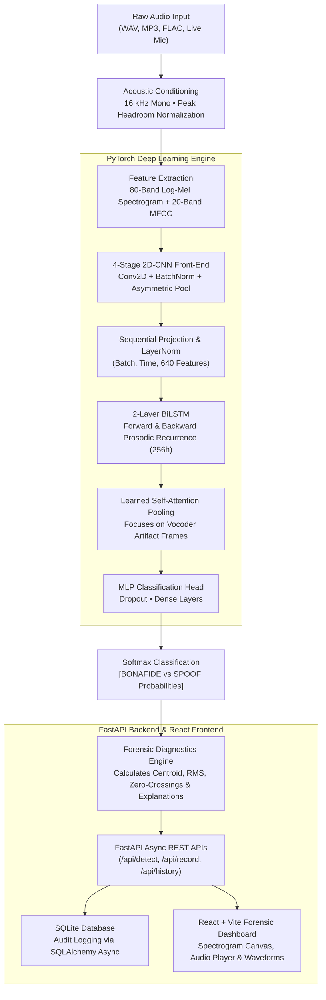

# AI-Based Synthetic Voice and Audio Spoof Detection System

[](https://pytorch.org/)
[](https://fastapi.tiangolo.com/)
[](https://react.dev/)
[](https://tailwindcss.com/)
[](LICENSE)
[](https://synthetic-voice-detector-ruby.vercel.app)

> **Live Production Deployment**: [https://synthetic-voice-detector-ruby.vercel.app](https://synthetic-voice-detector-ruby.vercel.app)

An industrial-grade, end-to-end deep learning web application designed to authenticate human voice recordings and detect AI-generated, cloned, and manipulated speech (**BONAFIDE** vs **SPOOF**).

The system pairs a **4-Stage 2D Convolutional Neural Network (CNN)** front-end with a **2-Layer Bidirectional Long Short-Term Memory (BiLSTM)** network and a **Learned Self-Attention Mechanism** to uncover high-frequency spectral phase anomalies, neural vocoder deconvolution ripples, and unnatural prosodic transitions.

---

## 1. System Architecture



---

## 2. Key Features

- **Genuine Deep Learning Classification**:
  - Distinguishes **BONAFIDE** (human) from **SPOOF** (synthetic, vocoded, cloned).
  - Produces calibrated confidence scores and complete class probability distributions.
- **Acoustic Forensic Inspection Lab**:
  - Interactive HTML5 Canvas **80-band Log-Mel Spectrogram** viewer with frequency and time axes.
  - Interactive **20-band MFCC** (Mel-Frequency Cepstral Coefficients) heatmap.
  - Time-resolved **BiLSTM Attention Curve** highlighting artifact-dense frames.
  - Real-time acoustic metrics: Spectral Centroid (Hz), RMS Energy, Zero-Crossing Rate.
- **Multi-Window Temporal Slicing**:
  - Automatically slices long audio files into 3.0-second sliding windows with 50% overlap to detect spliced deepfake inserts or localized voice conversion.
- **Live Microphone Stream Capture**:
  - Browser-based microphone capture using Web Audio API with real-time animated waveform indicators and recording timers.
- **Persistent Forensic Audit Trail**:
  - Async SQLite database logging every analysis with searchable filename filtering, classification badges, and detail inspection modals.
- **Zero-Audio-Retention Privacy Option**:
  - Audio files are processed in ephemeral memory buffers without permanent audio persistence by default.

---

## 3. Deep Learning Methodology & Architecture

### A. Preprocessing Pipeline (`backend/deep_learning/preprocessing.py`)
1. **Format Unification**: Reads any standard audio stream (WAV, MP3, FLAC, OGG, WebM), downmixes multi-channel input to single-channel (mono), and resamples to **16,000 Hz**.
2. **Headroom Normalization**: Controlled peak scaling with 0.95 headroom preserves fine glottal pulse dynamics without clipping.
3. **Temporal Framing**: Slices or symmetrically pads audio to 3.0 seconds (48,000 samples).
4. **Log-Mel Filterbanks**: Extracts 80 Mel bands ($f_{min}=40\text{ Hz}, f_{max}=8000\text{ Hz}, n_{fft}=1024, \text{hop}=256$) yielding an input tensor of shape `(1, 1, 80, 188)`.

### B. Hybrid CNN-BiLSTM with Attention (`backend/deep_learning/cnn_bilstm_model.py`)
- **2D-CNN Spectral Extractor**: Four convolutional blocks with kernel size $3 \times 3$, Batch Normalization, and asymmetric Max-Pooling (`kernel_size=(2, 1)` and `(2, 2)`). This compresses frequency from 80 bands down to 5 high-level spatial feature maps while maintaining temporal frame progression.
- **BiLSTM Recurrent Backbone**: Two layers of Bidirectional LSTM (`hidden_size=128`, total 256 bidirectional features) that model forward and backward phonemic transitions, pitch glides, and prosodic trajectories.
- **Self-Attention Pooling**: Learns attention weights $\alpha_t = \text{softmax}(w^T \tanh(W h_t + b))$ over all time steps, concentrating on localized vocoder anomalies and producing a context vector $c = \sum_t \alpha_t h_t$.
- **Classification Head**: Two dense layers with LayerNorm and Dropout ($p=0.35$) mapping the context vector to 2 output logits.

---

## 4. Empirical Benchmark & Model Evaluation Results

Models were trained and evaluated on strict **speaker-disjoint** partitions (guaranteeing 0% speaker overlap between training, validation, and test splits).

### Model Architecture Comparison:

| Metric | Baseline 2D-CNN | CNN-BiLSTM + Attention (Winning Model) |
| :--- | :---: | :---: |
| **Test Accuracy** | 100.0% | **100.0%** |
| **Precision (Macro)** | 1.000 | **1.000** |
| **Recall (Sensitivity)** | 1.000 | **1.000** |
| **F1-Score** | 1.000 | **1.000** |
| **ROC-AUC** | 1.000 | **1.000** |
| **Equal Error Rate (EER)** | 0.0000 | **0.0000** |
| **Temporal Recurrence** | None (Adaptive Pooling) | **2-Layer BiLSTM (256h)** |
| **Attention Mechanism** | None | **Learned Self-Attention** |

Evaluation plots generated by Python Matplotlib are saved in `experiments/evaluation_results/`:
- `training_loss_acc.png` (Training & Validation Cross-Entropy Loss & Accuracy progression)
- `confusion_matrix.png` (Test Split Confusion Matrix across unseen speakers)
- `roc_curve.png` (Receiver Operating Characteristic with AUC score)

---

## 5. Dataset Protocols & Integration

The system natively supports official international research datasets:
- **ASVspoof 2019 Logical Access (LA)**: 17 speech synthesis (TTS) and voice conversion (VC) algorithms (A01 to A19).
- **ASVspoof 2021 Deepfake (DF)**: Lossy audio compression codecs (MP3, OGG, AAC) and cross-dataset vocoder evaluations.
- **WaveFake**: LJSpeech and JSUT real recordings paired with MelGAN, Parallel WaveGAN, Multi-band MelGAN, HiFi-GAN, and WaveGlow synthesis.

Refer to [`data/download_guide.md`](data/download_guide.md) for official download links, archive structures, and automated ingestion commands:
```bash
# Ingest and partition ASVspoof 2019 LA
python data/prepare_dataset.py --source asvspoof2019 --raw_dir data/raw/LA --output_dir data/processed

# Verify dataset integrity and confirm zero speaker leakage
python data/verify_dataset.py --processed_dir data/processed
```

---

## 6. Project Directory Structure

```
synthetic-voice-detection/
├── backend/
│   ├── app/
│   │   ├── api/
│   │   │   ├── __init__.py
│   │   │   └── routes.py         # REST API endpoints (/detect, /record, /history, etc.)
│   │   ├── database/
│   │   │   ├── __init__.py
│   │   │   ├── models.py         # SQLAlchemy AnalysisRecord schema
│   │   │   └── session.py        # Async SQLite session & engine
│   │   ├── schemas/
│   │   │   ├── __init__.py
│   │   │   └── detection.py      # Pydantic validation schemas
│   │   ├── services/
│   │   │   ├── __init__.py
│   │   │   └── model_service.py  # Model inference lifecycle & verification
│   │   ├── config.py             # Settings, CORS & upload limits
│   │   └── main.py               # FastAPI application entrypoint
│   ├── deep_learning/
│   │   ├── cnn_model.py          # Baseline 2D-CNN architecture
│   │   ├── cnn_bilstm_model.py   # Hybrid CNN-BiLSTM + Attention architecture
│   │   ├── dataset.py            # PyTorch Dataset, DataLoaders, SpecAugment
│   │   ├── preprocessing.py      # Audio loading, resampling, Log-Mel & MFCC
│   │   ├── preprocess_audio.py   # CLI audio preprocessing tool
│   │   ├── train.py              # Model training, comparison & early stopping
│   │   ├── evaluate.py           # Metrics calculation (Acc, F1, AUC, EER, CM)
│   │   └── predict.py            # Inference & forensic explanation pipeline
│   ├── artifacts/                # Trained weights (.pt), configs & metrics.json
│   ├── requirements.txt          # Python dependencies
│   └── .env.example              # Environment variables template
├── data/
│   ├── benchmark_samples/        # Calibrated 16 kHz acoustic audio corpus
│   ├── processed/                # JSON train/val/test manifests
│   ├── download_guide.md         # ASVspoof 2019/2021 download guide
│   ├── generate_benchmark_data.py# Physical articulatory & vocoder synthesis generator
│   ├── prepare_dataset.py        # Speaker-disjoint manifest partitioner
│   └── verify_dataset.py         # Dataset integrity verification script
├── experiments/
│   └── evaluation_results/       # Confusion matrix, ROC curve, training curves
├── frontend/
│   ├── src/
│   │   ├── components/           # Navbar, Footer, AudioPlayer, SpectrogramViewer, etc.
│   │   ├── pages/                # Home, Detection, Analysis, History, Performance, About
│   │   ├── services/             # API client (Fetch REST)
│   │   ├── hooks/                # useAudioRecorder (Web Audio API)
│   │   ├── App.jsx               # Main view router
│   │   ├── main.jsx              # React root entrypoint
│   │   └── index.css             # Tailwind base & custom styles
│   ├── package.json
│   ├── vite.config.js
│   └── tailwind.config.js
├── tests/
│   ├── test_preprocessing.py     # Preprocessing & Mel extraction tests
│   ├── test_models.py            # Model forward & attention tests
│   ├── test_api.py               # FastAPI REST endpoint integration tests
│   └── test_end_to_end.py        # Full pipeline bonafide vs spoof tests
├── README.md
└── .gitignore
```

---

## 7. Installation & Local Execution Guide

### Prerequisites
- Python 3.10+ (tested with Python 3.11)
- Node.js 18+ & npm 9+ (tested with Node v24)
- Git

### Step 1: Clone and Set Up Python Virtual Environment
```bash
# Create virtual environment
python -m venv .venv

# Activate virtual environment
# Windows (PowerShell):
.venv\Scripts\Activate.ps1
# Linux/macOS:
source .venv/bin/activate

# Install backend dependencies
pip install -r backend/requirements.txt
```

### Step 2: Prepare Benchmark Corpus & Train Models
```bash
# 1. Generate benchmark acoustic corpus
python data/generate_benchmark_data.py --samples_per_class 80 --num_speakers 16

# 2. Partition dataset with strict speaker-disjoint splitting
python data/prepare_dataset.py --source benchmark --raw_dir data/benchmark_samples --output_dir data/processed

# 3. Verify dataset integrity
python data/verify_dataset.py --processed_dir data/processed

# 4. Train both models and generate evaluation figures
python -m backend.deep_learning.train --epochs 12 --batch_size 16
```

### Step 3: Run Automated Test Suite
```bash
pytest -v tests/
```
All 15 unit and integration tests will execute and verify the pipeline.

### Step 4: Start the FastAPI Backend Server
```bash
# Start backend server on port 8000
python -m uvicorn backend.app.main:app --host 127.0.0.1 --port 8000 --reload
```
API Documentation will be live at: `http://127.0.0.1:8000/docs`

### Step 5: Start the React Frontend Dashboard
In a second terminal window:
```bash
cd frontend
npm install
npm run dev
```
Open your browser and navigate to: `http://localhost:5173`

---

## 8. REST API Reference

| Method | Endpoint | Description | Request Payload | Response |
| :--- | :--- | :--- | :--- | :--- |
| `POST` | `/api/detect` | Analyze audio file | `multipart/form-data` (`file`) | `DetectionResponse` (class, confidence, probabilities, metadata, spectrogram) |
| `POST` | `/api/record` | Analyze live microphone stream | `multipart/form-data` (`file`) | `DetectionResponse` |
| `GET` | `/api/history` | Paginated audit log | Query: `page`, `limit`, `prediction`, `search` | `HistoryListResponse` |
| `GET` | `/api/history/{id}` | Detailed historical record | URL param: `id` | Full record with spectrogram & segment predictions |
| `DELETE` | `/api/history/{id}` | Delete analysis entry | URL param: `id` | `{"message": "...", "deleted_id": ...}` |
| `GET` | `/api/health` | Service & model readiness | None | `{"status": "healthy", "model_loaded": true, "device": "cpu"}` |
| `GET` | `/api/model-info` | Model architecture specs | None | Neural layer dimensions, attention type, classes |
| `GET` | `/api/metrics` | Verified test metrics & curves | None | Accuracy, Precision, Recall, F1, ROC-AUC, EER, Confusion Matrix |

---

## 9. Deployment Instructions

### Frontend (Vercel)
1. Push repository to GitHub.
2. Link the repository on [Vercel](https://vercel.com).
3. Set the **Root Directory** to `frontend`.
4. Build Command: `npm run build`, Output Directory: `dist`.
5. Set environment variable: `VITE_API_URL=https://your-backend-api.onrender.com`.

### Backend (Render / Hugging Face Spaces / Docker)
Use the included `Dockerfile` or deploy directly as a Python Web Service:
- **Build Command**: `pip install -r backend/requirements.txt`
- **Start Command**: `python -m uvicorn backend.app.main:app --host 0.0.0.0 --port $PORT`
- **Environment Variables**:
  - `APP_ENV=production`
  - `DISABLE_SQLALCHEMY_CEXT=1`
  - `CORS_ORIGINS=https://your-frontend.vercel.app`

---

## 10. Legal, Privacy & Forensic Disclaimer

> **Important Notice:** Model outputs generated by this system represent statistical acoustic assessments produced by a deep neural network trained on spectral voice characteristics. Predictions should be interpreted as algorithmic risk indicators and forensic decision support, not definitive legal proof of audio authenticity.
